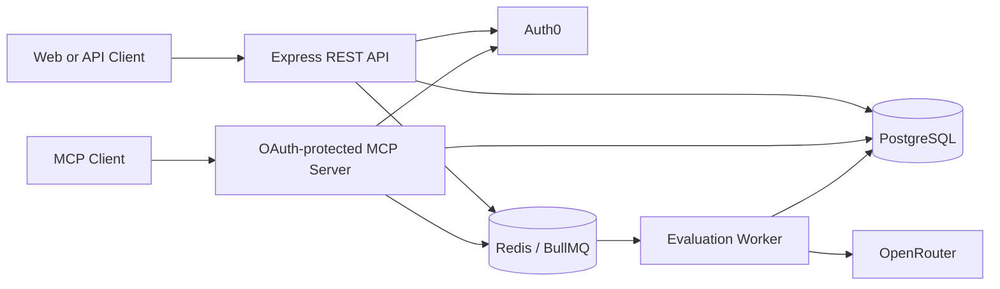

# AlgoSense Backend

Backend services for AlgoSense, an AI-assisted platform for practicing data structures and algorithms.

AlgoSense evaluates a user's written problem-solving approach, identifies missing edge cases, calculates performance scores, and maintains global and topic-specific ratings. It exposes both a REST API and an OAuth-protected Model Context Protocol (MCP) server with interactive HTML resources.

## Features

- DSA problem browsing and administration
- Asynchronous AI-assisted solution evaluation
- Approach and edge-case scoring
- Global and topic-specific rating tracking
- Attempt-aware rating adjustments
- Auth0 authentication and scope-based authorization
- REST and MCP interfaces
- Interactive MCP App resources
- PostgreSQL persistence with transactional score updates
- Redis-backed BullMQ processing
- Startup, liveness, and readiness probes
- Graceful process shutdown
- Soft deletion of users and problems

## Architecture



The API and MCP server run in one process. Submission evaluation runs in a separate worker process so that AI latency does not hold open HTTP requests.

### Submission lifecycle

1. The client submits a solution explanation.
2. The API validates the input and creates a `pending` submission.
3. The submission ID is added to the BullMQ queue.
4. The worker changes the submission to `evaluating`.
5. OpenRouter evaluates the approach and edge-case coverage.
6. The response is validated with Zod.
7. Submission results and user ratings are updated in one PostgreSQL transaction.
8. The submission becomes `completed`, or `failed` after an unrecoverable error or exhausted retries.
9. The client polls the submission endpoint for the final result.

## Technology stack

- Node.js 24
- TypeScript with NodeNext ESM
- Express 5
- PostgreSQL
- Redis and BullMQ
- Auth0
- OpenRouter
- Model Context Protocol
- Zod
- Jest and ts-jest
- Vite and `vite-plugin-singlefile`
- Docker

## Prerequisites

Install or provision:

- Node.js 24 and npm
- PostgreSQL with support for `uuidv7()`
- Redis
- An Auth0 tenant and API
- An OpenRouter API key

## Getting started

### 1. Install dependencies

```bash
npm install
```

### 2. Create the database

Create a dedicated PostgreSQL database, then apply the schema:

```bash
psql -d algosense -f src/infrastructure/data-access/init/1-schema.sql
```

The schema creates the `users`, `problems`, and `submissions` tables, along with their enum types, foreign keys, and indexes.

### 3. Configure the environment

Create a `.env` file in the project root:

```dotenv
NODE_ENV=development

# HTTP services
API_PORT=3001
MCP_PORT=3000
WORKER_HEALTH_PORT=3002

# MCP
MCP_PUBLIC_URL=http://localhost:3000/mcp
MCP_RESOURCE_HOST=localhost

# PostgreSQL
PGHOST=localhost
PGPORT=5432
PGUSER=postgres
PGPASSWORD=change-me
PGDATABASE=algosense

# Redis
REDIS_HOST=localhost
REDIS_PORT=6379

# Auth0
ISSUER_BASE_URL=https://your-tenant.auth0.com/
AUDIENCE=https://api.algosense.com

# AI evaluation
OPEN_ROUTER_KEY=change-me

# Load-testing configuration
LOAD_TEST=false
CLIENTID=
DOMAIN=
CLIENTSECRET=
TEST_USERS_PASSWORD=
```

Do not commit `.env` files or credentials.

### 4. Build the MCP resources

```bash
npm run build-mcp-resources
```

This creates the self-contained MCP HTML resources in `dist-mcp-resources/`.

### 5. Start the API and MCP server

```bash
npm run dev
```

By default:

- REST API: `http://localhost:3001`
- MCP endpoint: `http://localhost:3000/mcp`

When `LOAD_TEST=true`, the MCP server is disabled.

### 6. Start the evaluation worker

Run the worker in another terminal:

```bash
npm run dev-worker
```

The worker health server listens on `http://localhost:3002` by default.

## Authentication and authorization

The REST API validates Auth0 access tokens using the configured issuer, audience, and RS256 signatures.

Send protected requests with:

```http
Authorization: Bearer <access-token>
```

Authorization is enforced through scopes such as:

- `view:self`
- `delete:self`
- `view:self-submission`
- `view:partial-problem`
- `create:submission`
- `view:problem`
- `create:problem`
- `delete:problem`
- `view:user`
- `update:user`
- `delete:user`

The MCP server additionally requires the `mcp:connect` scope.

When a user authenticates for the first time, the backend can create the corresponding local profile from Auth0 custom claims.

## REST API

Except for the root and health endpoints, routes require authentication and the appropriate permission.

### General endpoints

| Method | Endpoint | Description |
| --- | --- | --- |
| `GET` | `/` | Return the API name |
| `GET` | `/startupz` | Report whether the listener has started |
| `GET` | `/livez` | Report process liveness |
| `GET` | `/readyz` | Report application and dependency readiness |

### User endpoints

| Method | Endpoint | Required scope | Description |
| --- | --- | --- | --- |
| `GET` | `/user/profile` | `view:self` | Return the authenticated user's profile |
| `GET` | `/user/submissions` | `view:self-submission` | List the user's submissions |
| `POST` | `/user/submitSolution` | `create:submission` | Create and enqueue a submission |
| `GET` | `/user/getSubmission/:id` | `create:submission` | Return a submission and its current status |
| `DELETE` | `/user/delete` | `delete:self` | Soft-delete the authenticated user |

Pagination endpoints accept `page` and `perPage` query parameters.

### Problem endpoints

| Method | Endpoint | Required scope | Description |
| --- | --- | --- | --- |
| `GET` | `/problem/all` | `view:partial-problem` | List user-visible problems |
| `GET` | `/problem/byId/:id` | `view:partial-problem` | Find a problem by ID |
| `GET` | `/problem/bySlug/:slug` | `view:partial-problem` | Find a problem by slug |

User-facing problem responses omit evaluation details that would reveal expected solutions.

### Administration endpoints

| Method | Endpoint | Required scope | Description |
| --- | --- | --- | --- |
| `GET` | `/admin/problems` | `view:problem` | List problems with administrative data |
| `GET` | `/admin/problem/:id` | `view:problem` | Find a problem by ID |
| `GET` | `/admin/problem/slug/:slug` | `view:problem` | Find a problem by slug |
| `POST` | `/admin/problem/create` | `create:problem` | Create a problem |
| `DELETE` | `/admin/problem/:id` | `delete:problem` | Soft-delete a problem |
| `GET` | `/admin/users` | `view:user` | List and filter users |
| `PUT` | `/admin/users/:userId` | `update:user` | Update a user |
| `DELETE` | `/admin/users/:id` | `delete:user` | Soft-delete a user |

## Submitting a solution

```http
POST /user/submitSolution
Authorization: Bearer <access-token>
Content-Type: application/json

{
  "problem_id": "019a1234-5678-7000-8000-123456789abc",
  "userInput": "I would use a hash map to track previously seen values..."
}
```

The explanation must contain between 20 and 3,000 characters.

The API immediately returns an identifier:

```json
{
  "success": {
    "submission_id": "019a9876-5432-7000-8000-abcdef123456"
  }
}
```

Poll for the result:

```http
GET /user/getSubmission/019a9876-5432-7000-8000-abcdef123456
Authorization: Bearer <access-token>
```

Submission statuses are:

- `pending`
- `evaluating`
- `completed`
- `failed`

## MCP interface

The MCP server is exposed at:

```text
POST /mcp
```

Available tools include:

| Tool | Description |
| --- | --- |
| `get_my_profile` | Display the authenticated user's profile |
| `see-my-submissions` | Display paginated submission history |
| `submit-solution` | Submit an explanation for evaluation |
| `check-submission` | Check an evaluation's status |
| `delete-user-profile` | Soft-delete the authenticated profile |
| `view-all-problems` | Display paginated problems |
| `find-problem-by-id` | Find and display a problem by ID |
| `find-problem-by-slug` | Find and display a problem by slug |

Interactive views are built as self-contained HTML files and served from `dist-mcp-resources/`.

After editing an MCP HTML template or browser script, rebuild the resources:

```bash
npm run build-mcp-resources
```

The development server does not rebuild these resources automatically.

## Rich Input ELO rating system

AlgoSense uses a **Rich Input ELO rating system** instead of treating a submission as a simple accepted-or-rejected result. The platform evaluates the quality of the user's reasoning and uses that richer performance signal to update both an overall rating and topic-specific ratings.

Each problem contains its expected approaches, explanation requirements, complexity information, evaluation criteria, and edge cases weighted by importance. The evaluation combines this structured problem data with the AI's analysis of the submitted explanation. It considers:

- Which expected approach the user identified
- Whether that approach is optimal, correct, partially correct, or incorrect
- Whether the explanation passes the problem's evaluation criteria
- Which important points are missing from the explanation
- Whether each edge case was covered correctly, partially, incorrectly, or not at all
- The problem's configured difficulty and rating
- The user's number of attempts on the same problem

The categorical AI output is converted into deterministic numeric inputs. Approach quality maps to an approach score, while edge-case coverage is combined with each edge case's `critical`, `high`, `medium`, or `low` importance. Together with the problem difficulty, these values form the user's performance for the submission:

```math
User\ Performance = 0.55 \times \frac{Approach\ Score}{100}
+ 0.25 \times \frac{Edge\ Case\ Score}{100}
+ 0.20 \times \frac{Difficulty\ Weight}{100}
```

### Global and topic-specific ratings

Every user has a global ELO rating as well as individual ratings for the DSA topics they have practiced. For a given problem, the expected performance calculation considers:

- 50% of the user's global ELO rating
- 30% from the user's ratings across the problem's primary topics
- 20% from the user's ratings across the problem's secondary topics

When no useful topic history exists, the global rating is used as the fallback. This lets a user's profile express strengths independently; for example, a user may have a strong `dynamic-programming` rating while still developing their `graphs` rating.

The resulting effective user rating is compared with the problem's rating using the ELO probability function:

```math
Expected\ Performance = \frac{1}{1 + 10^{\frac{Problem\ Rating - Effective\ User\ Rating}{400}}}
```

The rating change is then based on the difference between actual and expected performance:

```math
\Delta R = Attempt\ Modifier \times K \times (Actual\ Performance - Expected\ Performance)
```

The global ELO rating and primary-topic ratings receive the full calculated change. Secondary-topic ratings receive half of that change. Repeated attempts progressively reduce the modifier, which limits rating gains from repeatedly submitting against the same problem.

### Profile scores

Alongside ELO ratings, AlgoSense maintains three easier-to-read indicators:

- **Approach score:** a difficulty-weighted average of approach quality across submissions
- **Edge-case score:** a difficulty-weighted average of edge-case coverage
- **Consistency score:** a measure based on the user's practice activity

These are combined into the user's total score:

```math
Total\ Score = 0.45 \times Approach\ Score
+ 0.35 \times Edge\ Case\ Score
+ 0.20 \times Consistency\ Score
```

Submission results, aggregate scores, the global ELO rating, and affected topic ratings are updated together inside a PostgreSQL transaction. See [user-rating-system.md](user-rating-system.md) for the complete formulas, mappings, examples, and rationale behind the model.

## Health probes

The API and worker expose separate health probes.

| Endpoint | Meaning |
| --- | --- |
| `/startupz` | The process listener started successfully |
| `/livez` | The process can respond |
| `/readyz` | The process is started, not shutting down, and its dependencies are healthy |

REST readiness checks PostgreSQL and the producer queue.

Worker readiness checks PostgreSQL, the worker's Redis connections, and whether the BullMQ worker is running and not paused.

Dependency failures affect readiness but not liveness, preventing temporary PostgreSQL or Redis failures from causing restart loops.

## Available scripts

| Command | Description |
| --- | --- |
| `npm run dev` | Watch and run the REST and MCP servers |
| `npm run dev-worker` | Watch and run the evaluation worker |
| `npm run build` | Compile TypeScript into `dist/` |
| `npm run build-mcp-resources` | Build the five MCP HTML resources |
| `npm run start` | Run the compiled API and MCP servers |
| `npm run start-worker` | Run the compiled worker |
| `npm test` | Run the Jest test suite |
| `npx tsc --noEmit` | Type-check the backend source |
| `npm run test-mcp` | Open the MCPJam inspector |

For a production build:

```bash
npm run build
npm run build-mcp-resources
```

The server and worker must then run as separate processes:

```bash
npm run start
npm run start-worker
```

## Testing

Run all tests:

```bash
npm test
```

Run one suite:

```bash
npm test -- src/use-cases/user/tests/register.test.ts
```

Type-check the source:

```bash
npx tsc --noEmit
```

DAO integration tests use a real PostgreSQL database and write fixtures. Always use a dedicated test database.

The repository also includes k6 load-test scripts under:

```text
src/infrastructure/api/express/load-tests/
```

Generated reports are stored in `load-test-reports/`.

## Docker

Build the image:

```bash
docker build -t algosense-backend .
```

The image builds both the TypeScript backend and MCP HTML resources. It exposes ports `3000`, `3001`, and `3002`.

The default container command starts the API and MCP process. Run the worker as a separate container using:

```bash
node dist/infrastructure/queue/bullmq/worker.js
```

Both containers require access to the same PostgreSQL database and Redis instance.

## Project structure

```text
.
├── build-scripts/
│   └── build-mcp-resources.mjs
├── src/
│   ├── config/                 # Configuration, dependencies, and scoring weights
│   ├── controllers/            # Request-to-use-case coordination
│   ├── entities/               # Domain models
│   ├── errors/                 # Domain HTTP errors
│   ├── interfaces/             # Application contracts
│   ├── infrastructure/
│   │   ├── api/express/        # REST API, routes, middleware, and load tests
│   │   ├── data-access/        # PostgreSQL DAOs and schema
│   │   ├── health-probes/      # Startup, liveness, and readiness probes
│   │   ├── mcp/                # MCP server, tools, and interactive resources
│   │   ├── queue/bullmq/       # Queue adapter and evaluation worker
│   │   ├── utils/              # Auth, AI evaluation, scoring, and notifications
│   │   └── validation/zod/     # Input and model-response validation
│   ├── use-cases/
│   │   ├── admin/
│   │   └── user/
│   └── server.ts
├── Dockerfile
├── implementation-decisions.md
├── user-rating-system.md
└── vite.config.ts
```

## Error responses

Errors are serialized by the centralized Express error handler:

```json
{
  "error": "ValidationError",
  "message": "User Input Invalid",
  "details": [
    {
      "field": "userInput",
      "message": "Solution must be at least 20 characters long"
    }
  ]
}
```

Depending on the environment and error, `originalError` may also be present.

## Design notes

- Submissions are evaluated asynchronously to isolate API latency from AI-provider latency.
- Score and rating updates occur inside PostgreSQL transactions.
- Worker concurrency and AI request rates are bounded.
- BullMQ jobs use exponential retry backoff.
- Users and problems use soft deletion so historical submissions retain valid relationships.
- MCP resources are generated separately from the backend TypeScript build.
- The server should be launched from the project root because MCP HTML paths are resolved from the working directory.

Further implementation rationale is documented in [implementation-decisions.md](implementation-decisions.md).
