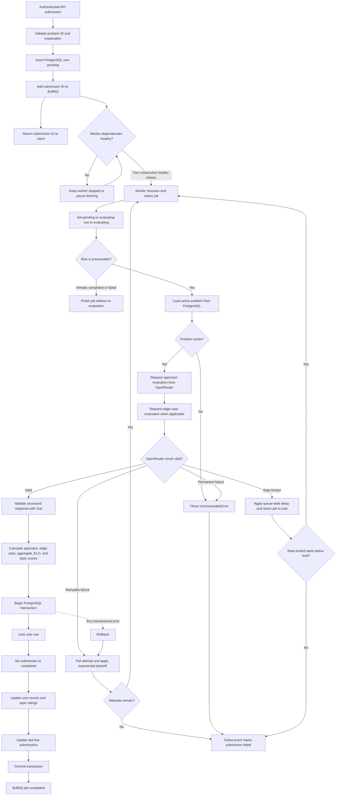
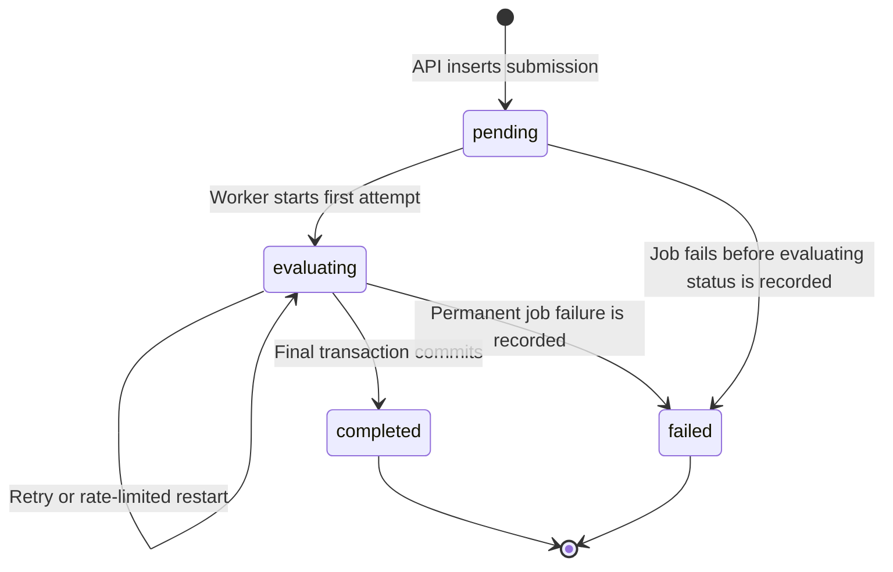

# BullMQ Submission Evaluation Worker

This document describes the asynchronous submission-evaluation pipeline implemented by the AlgoSense BullMQ worker. It covers job creation, worker startup, dependency health checks, OpenRouter behavior, retries, submission status changes, transactional updates, outage recovery, shutdown, and current operational limitations.

The main implementation files are:

- `src/infrastructure/queue/bullmq/worker.ts`
- `src/infrastructure/queue/bullmq/evaluationQueue.ts`
- `src/infrastructure/queue/bullmq/queue.ts`
- `src/infrastructure/utils/logic/askGPT.ts`
- `src/infrastructure/health-probes/workerProbe.ts`
- `src/infrastructure/health-probes/probe.ts`
- `src/infrastructure/data-access/client.ts`
- `src/infrastructure/data-access/submissionDAO.ts`
- `src/use-cases/user/submitSolution.ts`

## Why evaluation runs in a worker

Solution evaluation can require two external AI requests, result validation, score calculations, and several database writes. Running that work inside the API request would tie API latency and availability to OpenRouter.

Instead, the API performs only the durable intake work:

1. Validate the user, problem, and submitted explanation.
2. Insert a PostgreSQL submission with status `pending`.
3. Enqueue the submission ID in Redis.
4. Return the submission ID immediately.

The worker independently evaluates the submission and updates its final result. Clients can poll the submission endpoint while this happens.

## Components and dependencies

| Component | Responsibility |
| --- | --- |
| PostgreSQL | Stores submissions, problems, users, scores, and the last-five-submissions profile summary |
| Redis | Stores BullMQ queue state, delayed retries, locks, rate-limit state, and retained job records |
| BullMQ `Queue` | Enqueues submission IDs and applies default job options |
| BullMQ `Worker` | Claims jobs, renews locks, executes evaluations, retries failures, and emits lifecycle events |
| OpenRouter | Produces structured approach and edge-case evaluations |
| Zod validators | Validate the final model response before it can affect scores |
| Express health server | Exposes worker startup, liveness, and readiness endpoints |
| PostgreSQL transaction | Atomically finalizes a submission and updates the user's scores and recent submissions |

The worker does not authenticate end users and does not directly use Auth0. Authentication and permission checks happen before the API creates the submission.

## Runtime configuration

### Queue defaults

The `submission-evaluation-queue` applies these options to every job:

| Setting | Value | Effect |
| --- | --- | --- |
| Attempts | `5` | A normally retryable failure can start up to five ordinary attempts |
| Backoff | Exponential, base `5,000 ms` | Retry delays are 5, 10, 20, and 40 seconds after successive failed attempts |
| Completed retention | One day, at most 10,000 jobs | Removes old BullMQ job metadata, not PostgreSQL submissions |
| Failed retention | Seven days, at most 10,000 jobs | Retains failed BullMQ metadata longer for diagnosis |

Retention is best-effort and is evaluated as later jobs finish.

### Worker options

| Setting | Value | Effect |
| --- | --- | --- |
| `autorun` | `false` | The worker does not consume jobs until the dependency probe starts it |
| Concurrency | `5` | One process evaluates at most five jobs concurrently |
| Rate limiter | 10 jobs per 60 seconds | Limits job starts; it does not directly count individual OpenRouter HTTP calls |
| `maxStartedAttempts` | `20` | Prevents a job from starting indefinitely, including starts that do not count as ordinary failed attempts |

One evaluation can make up to two OpenRouter calls, so the 10-job limiter is not equivalent to a strict 10-request OpenRouter limit.

## End-to-end processing flow



## Enqueueing and job identity

`SubmitSolution` creates the PostgreSQL record before adding the job. The job body is the submission ID string, and the BullMQ job ID is also set to that same value:

```text
job name: submission-evaluation-job
job data: <submission-id>
job id:   <submission-id>
```

Using the submission ID as the BullMQ job ID gives the queue a stable identity for the unit of work and helps prevent duplicate queue records while the original job record still exists.

If the PostgreSQL insert succeeds but queue insertion fails, the API throws an internal error but the `pending` row remains. There is currently no outbox or reconciliation task that automatically discovers and re-enqueues this orphaned submission.

## Worker startup and readiness control

The worker is constructed with `autorun: false`. Its health server then listens on `0.0.0.0` using `WORKER_HEALTH_PORT`, which defaults to `3002`.

After the health listener starts:

1. The probe marks the process as started.
2. Dependency monitoring begins immediately.
3. Monitoring repeats every five seconds.
4. Overlapping dependency checks are prevented.
5. The worker starts only after two consecutive successful checks.

The worker readiness probe checks:

- PostgreSQL with `SELECT 1`
- The BullMQ worker's normal Redis connection
- The BullMQ worker's blocking Redis connection
- Whether the worker is running, not paused, and not closing

The producer-side `Queue` connection imported by the worker is used for manual rate limiting and shutdown, but it is not a separate worker-readiness check.

### Health endpoints

| Endpoint | Healthy response | Dependency behavior |
| --- | --- | --- |
| `/startupz` | `200` after the health listener starts | Does not depend on PostgreSQL or Redis |
| `/livez` | Always `200` while the process can respond | Deliberately unaffected by dependency outages |
| `/readyz` | `200` only while the worker and dependencies are ready | Returns `503` during startup, outages, pauses, stale checks, or shutdown |

A completed dependency check is considered fresh for 15 seconds. PostgreSQL pool acquisition has a two-second connection timeout, and the health query has a two-second query timeout. A connection that fails its health query is discarded rather than returned to the pool for reuse.

## Dependency outage behavior

### Pausing after failures

The probe counts consecutive failed dependency checks. After three failures, it calls:

```ts
worker.pause(true)
```

This pauses this worker instance so it stops fetching new jobs. Passing `true` means the pause does not wait for already active jobs to finish. Active jobs may therefore complete or encounter their own dependency errors while new work is paused.

At a five-second check interval, the pause occurs after three failed monitoring cycles. `/readyz` remains unavailable throughout the outage.

### Resuming after recovery

When PostgreSQL and both worker Redis connections are healthy again, the probe requires two consecutive successful checks before calling `worker.resume()`.

This short hysteresis prevents a single transient success from immediately reopening job consumption. PostgreSQL's pool and BullMQ's Redis connections perform the underlying reconnection work; the probe observes their state and controls whether the worker may fetch jobs.

### PostgreSQL outage during a job

PostgreSQL can be needed at several stages:

- Changing the submission to `evaluating`
- Loading the problem
- Loading and locking the user
- Reading prior completed scores
- Finalizing the submission
- Updating user scores
- Updating the last-five-submissions list

An error at one of these stages normally becomes a retryable job failure. BullMQ then applies the configured attempt count and exponential backoff.

The first status update happens outside the final transaction. As a result, a submission can remain `evaluating` while an attempt waits to retry. The next attempt accepts both `pending` and `evaluating` rows.

If the database remains unavailable until all attempts are exhausted, the failed-event handler tries to mark the submission `failed`. That write also needs PostgreSQL. If it fails, the error is logged and the submission may remain `pending` or `evaluating`; there is currently no retry queue for this final status write.

### Redis outage

During a Redis outage:

- The API producer cannot reliably enqueue new jobs.
- The worker cannot claim jobs, renew locks, apply queue-wide rate limits, or finalize BullMQ state.
- The worker's Redis readiness check fails and eventually pauses local consumption.
- BullMQ/ioredis reconnect in the background according to their connection behavior.
- After both worker Redis connections and PostgreSQL pass two consecutive checks, the probe resumes consumption.

BullMQ also provides its normal stalled-job recovery. This project uses BullMQ's defaults for stalled checks, lock duration, and maximum stalled recovery count. A job whose lock is lost can be returned to waiting for another processing start; repeated stalls can eventually fail the job. `maxStartedAttempts` places an additional ceiling on total starts.

### OpenRouter outage

OpenRouter is not part of the readiness probe. An OpenRouter outage does not pause the entire worker; instead, affected jobs follow the OpenRouter error classification and BullMQ retry policy described below. This keeps database and Redis readiness separate from an external model provider's availability.

## OpenRouter evaluation

In normal mode, `askGPT` can make two sequential requests:

1. Identify the user's approach, rate the explanation, determine pass/fail, and list missing points.
2. For the identified approach, rate coverage of each configured edge case.

If the identified approach cannot be matched or has no edge cases, the second call is skipped.

The request supplies a model preference list to OpenRouter:

- `nvidia/nemotron-3-super-120b-a12b:free`
- `tencent/hy3:free`
- `poolside/laguna-xs-2.1:free`

Responses must contain JSON matching the requested schema. The completed model result is then validated again by the application's model-response validator before scoring.

In load-testing mode, `askGPT` returns a static model response and does not call OpenRouter.

## OpenRouter errors and retries

### Manual rate-limit path

The following responses become `OpenRouterRateLimitError`:

- HTTP or provider error code `429`
- Error code `402` with metadata reason `in_flight_budget_exhausted`

The worker determines the delay from `Retry-After`, supporting either seconds or an HTTP date. It uses a default of 60 seconds when the header is absent and enforces a minimum delay of one second.

It then:

1. Calls `evaluationQueue.rateLimit(delay)` to set a queue-wide BullMQ rate limit.
2. Throws `Worker.RateLimitError()`.
3. BullMQ moves the current job back to waiting instead of counting it as an ordinary failed attempt.

Manual rate limiting does not increment `attemptsMade`, but every processing start increments `attemptsStarted`. If the worker receives another rate-limit error when `attemptsStarted >= 20`, it throws `UnrecoverableError` instead. The job then fails permanently and the submission is marked `failed` when PostgreSQL is available.

### Normally retryable OpenRouter failures

These failures consume a standard BullMQ attempt and use exponential backoff:

- Network or connection failures
- HTTP `408`
- HTTP `500`
- HTTP `502`
- HTTP `503`
- HTTP `524`
- HTTP `529`
- A successful HTTP response containing malformed JSON
- A completion without message content
- Completion content that is not valid JSON

Because `askGPT` is one worker step, a failure during the second OpenRouter request causes the whole job attempt to restart. The next attempt repeats the first request as well.

### Non-retryable OpenRouter failures

An OpenRouter HTTP/provider error outside the retryable and rate-limit classifications becomes an `OpenRouterError` with `retryable: false`. The worker converts it to `UnrecoverableError`, bypassing the remaining ordinary attempts.

This generally includes client, authentication, permission, and other permanent response codes unless they match one of the explicitly retryable cases above.

### OpenRouter retry decision table

| Failure | Worker action | Ordinary attempt consumed? | Final outcome |
| --- | --- | --- | --- |
| `429` | Queue-wide delay plus `Worker.RateLimitError` | No | Requeued until recovery or the start ceiling |
| `402` with `in_flight_budget_exhausted` | Same as `429` | No | Requeued until recovery or the start ceiling |
| Network error | Throw retryable `OpenRouterError` | Yes | Exponential retry, then failure after attempt five |
| `408`, `500`, `502`, `503`, `524`, `529` | Throw retryable `OpenRouterError` | Yes | Exponential retry, then failure after attempt five |
| Malformed provider/completion JSON | Throw retryable `OpenRouterError` | Yes | Exponential retry, then failure after attempt five |
| Other provider error | Throw `UnrecoverableError` | No further retries | Permanent failure immediately |
| Worker cancellation signal | Throw `UnrecoverableError` | No further retries | Permanent failure |

There is no application-level timeout around an OpenRouter request. The fetch receives BullMQ's abort signal, so cancellation can interrupt it, but ordinary provider latency is otherwise governed by the HTTP stack and provider.

## Ordinary BullMQ retry lifecycle

For errors that are not manual rate limits or `UnrecoverableError`:

1. The worker throws an error from the processor.
2. BullMQ moves the job through its failed-attempt handling.
3. The worker's `failed` event fires.
4. If attempts remain, the listener logs that the submission will be retried and leaves the database status as `evaluating`.
5. BullMQ delays the next attempt using exponential backoff.
6. On the fifth failed attempt, the listener treats the job as permanently failed and calls `markFailed`.

The retry schedule is:

| Failed attempt | Delay before next attempt |
| --- | --- |
| 1 | 5 seconds |
| 2 | 10 seconds |
| 3 | 20 seconds |
| 4 | 40 seconds |
| 5 | No next attempt |

An `UnrecoverableError` skips this schedule and immediately enters permanent-failure handling.

The worker-level `error` event is different from a job-level `failed` event. Worker errors are logged as BullMQ infrastructure errors and do not directly mark a particular submission as failed.

### Failure classification outside OpenRouter

| Failure | Classification | Behavior |
| --- | --- | --- |
| Submission status update throws | Retryable `InternalServerError` | Uses the ordinary five-attempt policy |
| Submission is already terminal | Successful no-op | The processor returns and BullMQ completes the duplicate/stale job |
| Problem lookup throws | Retryable `InternalServerError` | Uses the ordinary five-attempt policy |
| Problem no longer exists | `UnrecoverableError` | Fails immediately |
| Model-response validator throws or rejects the response | Retryable `InternalServerError` | Repeats the entire evaluation attempt |
| User lookup throws | Retryable `InternalServerError` | Rolls back and retries |
| User no longer exists | `UnrecoverableError` | Rolls back and fails immediately |
| Score calculation produces an invalid rating change | Retryable `InternalServerError` | Rolls back and retries |
| Final submission or user update fails | Retryable `InternalServerError` | Rolls back and retries |
| Rollback itself fails | `InternalServerError` from the transaction runner | The attempt fails; the connection is released and BullMQ applies its policy |
| Abort signal is set | `UnrecoverableError` | Fails without further ordinary retries |

The permanent-failure database update is launched from the BullMQ `failed` event after BullMQ has already decided the job is terminal. It is therefore a best-effort synchronization of PostgreSQL state, not part of the BullMQ failure transition itself.

## Submission status lifecycle



Status behavior is enforced by DAO queries:

- `createInitial` inserts `pending`.
- `updateStatus(..., "evaluating")` only updates rows currently in `pending` or `evaluating`.
- A job for an already `completed` or `failed` row receives no processable row and exits without evaluating again.
- `createFinalSubmission` writes the evaluation fields and changes the status to `completed` inside the final transaction.
- `markFailed` only changes rows still in `pending` or `evaluating`.

These guards make retries tolerant of an existing `evaluating` status and protect terminal submissions from the failed-event handler. They are not a complete exactly-once guarantee; BullMQ processing should still be treated as at-least-once execution.

## Scoring and persistence stages

After a valid model response, the worker calculates:

- Approach score: `optimal=100`, `correct=75`, `partially_correct=50`, `incorrect=0`
- Edge-case score using importance weights (`critical=4`, `high=3`, `medium=2`, `low=1`)
- Edge-case coverage multipliers (`correct=1`, `partial=0.6`, `incorrect=0.2`, `missing=0`)
- Difficulty-weighted aggregate approach and edge-case scores
- Total profile score
- Global ELO change
- Primary and secondary topic-rating changes
- A newest-first last-five-submissions summary

The detailed rating formula is documented in [user-rating-system.md](user-rating-system.md).

The worker's final database phase runs through `runInTransaction`:

1. Acquire a PostgreSQL connection.
2. Execute `BEGIN`.
3. Lock and read the user with `findByIdForUpdate`.
4. Read the user's best completed score per problem.
5. Calculate aggregate and rating changes.
6. Update the submission to `completed` with the evaluation result.
7. Update the user's scores and topic ratings.
8. Update the user's last-five-submissions list.
9. Execute `COMMIT`.

If any step fails, the transaction executes `ROLLBACK` and the job attempt fails. This prevents a committed `completed` submission from being separated from its related user-score and recent-submission updates.

The status change to `evaluating` occurs before this transaction and is therefore not rolled back with finalization failures.

### Current attempt-count behavior

`calculateNewUserScores` reads `viewScoresByUser`, which returns one best completed submission per problem. The attempt counter used by the rating modifier is incremented from that result. Consequently, the current worker can distinguish whether a completed score for the problem already contributes to the aggregate, but it does not count every historical raw submission row. The DAO has a separate submission-count method, but the worker does not currently use it for the modifier.

## Idempotency and concurrency protections

- The BullMQ job ID is the submission ID.
- Only `pending` and `evaluating` submissions can enter an evaluation attempt.
- Completed and failed submissions are treated as terminal by the initial status update.
- BullMQ locks prevent two healthy workers from normally owning the same active job simultaneously.
- The user row is locked with `SELECT ... FOR UPDATE` semantics before rating changes are calculated and written.
- Submission finalization and all related user updates share one transaction.
- The worker supports five concurrent jobs, while the PostgreSQL pool supports ten connections.

These protections reduce duplicate and lost updates, but external model calls necessarily occur before the database transaction. A retried job may therefore repeat an OpenRouter request even though no score changes were committed from the earlier attempt.

## Graceful shutdown

The worker handles `SIGTERM` and `SIGINT` once.

Shutdown order is:

1. Mark the worker probe as shutting down.
2. Stop the dependency-monitor timer and make readiness fail.
3. Await `worker.close()`, allowing active jobs to drain.
4. Close the PostgreSQL pool and producer queue with `Promise.allSettled`.
5. Close the worker health HTTP listener last.
6. Set a non-zero process exit code if any shutdown stage failed.

PostgreSQL remains available until `worker.close()` returns so active jobs can finish their transactions. Independent dependency closures use `Promise.allSettled`, ensuring one cleanup failure does not prevent the other cleanup from being attempted.

The abort signal checked throughout the processor provides a cancellation boundary. When aborted, it is converted to `UnrecoverableError`, and the same signal is passed to OpenRouter fetch calls.

## Operating the worker

Development:

```bash
npm run dev-worker
```

Compiled production process:

```bash
npm run start-worker
```

Relevant environment variables:

```dotenv
WORKER_HEALTH_PORT=3002
REDIS_HOST=localhost
REDIS_PORT=6379
PGHOST=localhost
PGPORT=5432
PGUSER=postgres
PGPASSWORD=change-me
PGDATABASE=algosense
OPEN_ROUTER_KEY=change-me
LOAD_TEST=false
```

Useful operational signals include:

- `/readyz` changing to `503`: PostgreSQL, worker Redis, or local worker state is unhealthy.
- `Worker paused because dependencies are unavailable`: three consecutive dependency checks failed.
- `Worker resumed after dependencies checked`: two consecutive recovery checks passed.
- `Submission ... failed and will be retried`: an ordinary attempt failed but attempts remain.
- `Marking submission as failed`: retry exhaustion or an unrecoverable error reached terminal handling.
- `Couldn't mark submission ... as failed`: the job is terminal in BullMQ, but PostgreSQL did not accept the final failure status.
- `BullMQ worker error`: a worker-level infrastructure error rather than a normal processor failure.

## Current recovery boundaries

The worker is designed to recover automatically from temporary PostgreSQL, Redis, network, and retryable OpenRouter failures. The following cases still require operational reconciliation or a future code change:

- A `pending` database row whose queue insertion failed
- A terminal BullMQ failure whose `markFailed` database write also failed
- A non-retryable OpenRouter configuration or authentication error
- An OpenRouter rate limit that persists through the start ceiling
- A permanently missing or deleted problem or user
- A malformed model response that continues through all five attempts

Monitoring should therefore consider both BullMQ state and PostgreSQL submission state rather than treating either system as the sole source of pipeline health.
